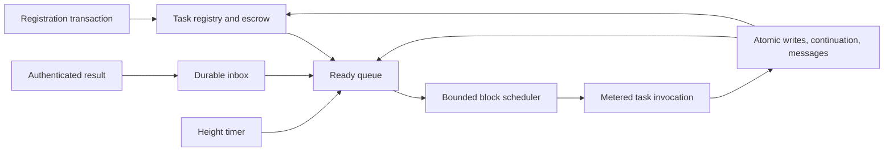

# Native durable async execution for CosmWasm

Status: proposed architecture for review. No native runtime functionality described here is implemented by this document.

## Purpose and decisions

Contracts should be able to register long-lived computations that the chain resumes automatically across blocks, with deterministic scheduling and explicit payment for execution and retained state. Developers should write async functions rather than maintain callback routing and continuation records manually.

The existing [library design](2026-10-03-cosmwasm-durable-async-design.md) demonstrates restricted async syntax lowered into serializable continuations. It relies on ordinary contract transactions for advancement and expiration. This proposal adds a native task ABI, consensus-owned task storage, a block scheduler, and task fee escrow. It preserves the existing prototype as a separate deployment option.

The recommended execution representation is an explicit durable continuation. Native scheduling and richer Rust authoring are separate workstreams: the scheduler can initially run continuations emitted by the existing compiler. Support for ordinary compiler-generated Rust futures through persistent Wasm instances is an alternative execution representation, described below, not a prerequisite for native scheduling.

Core decisions:

- The scheduler runs once per block after ordinary transactions, at an explicitly ordered application hook.
- Event-driven tasks sleep until a timer or authenticated result wakes them. Recurring polling is an explicit paid option.
- Best-effort scheduling is the initial service class. Guaranteed per-block polling requires a separate capacity reservation mechanism.
- Every poll has a bounded gas budget and executes as an isolated atomic state transition.
- Tasks prepay execution through escrow. Host accounting survives rollback of task execution.
- Every async-capable contract exposes a standard funding and balance-query interface backed by scheduler escrow.
- Out-of-gas pauses a task at its last committed continuation; it does not checkpoint arbitrary instructions.
- Live tasks block contract migration in the first version. Explicit continuation migration is a later extension.

## Scope and success criteria

The first runtime must register a funded task, invoke it without a subsequent user transaction, suspend it, survive node restart and state sync, accept an authenticated result, and complete it in a later block. Every validator must derive the same task order, gas charges, and state root from the same block inputs.

Sleeping tasks must not require a scan of all registered tasks every block. Polling, readiness processing, expiration, and cleanup must all have bounded block work. A task that traps, exhausts gas, or emits a failing message must not halt the block or consume another task's escrow.

Initial exclusions are arbitrary Rust futures, persisted native execution stacks, automatic compensation, off-chain network access from Wasm, unbounded child-task spawning, and guaranteed execution of every task in every block. Compiler improvements can add branches, loops, durable helper calls, and structured concurrency in stages without changing those exclusions implicitly.

## Developer experience

The intended authoring surface is illustrated below. Names and signatures are conceptual, not existing APIs or a finalized Rust interface.

```rust
#[durable(kind = "fulfill", version = 1)]
async fn fulfill(ctx: TaskContext, order: Order) -> Result<Receipt, Error> {
    let payment = ctx.request(
        payment_service(),
        PaymentRequest::new(&order),
        ctx.height() + 100,
    ).await?;

    let shipment = ctx.request(
        shipping_service(),
        ShipmentRequest::new(&order, payment),
        ctx.height() + 500,
    ).await?;

    ctx.sleep_blocks(10).await;
    Ok(Receipt { order_id: order.id, shipment })
}

// An authorized ordinary execute call registers the generated task descriptor.
let task_id = ctx.spawn(
    fulfill::task(order),
    TaskBudget {
        gas_per_poll: 500_000, // illustrative SDK gas units, not a calibrated default
        fee_escrow: attached_funds,
        max_gas_price: price_limit,
        expires_at: ctx.height() + 10_000,
    },
)?;
```

The compiler produces a descriptor and a versioned continuation handler. The chain registers bytes and metadata, not a Rust pointer. The initial implementation may require explicit checkpoint fields as in the existing prototype; automatic capture is a separate compiler milestone.

`TaskContext` is reconstructed for each invocation. Storage access and message dispatch use the current invocation's capabilities. `DepsMut`, storage iterators, references into temporary storage, and other invocation-bound resources cannot survive suspension. Values read before a suspension are snapshots; application code must revalidate them or establish an explicit on-chain reservation before acting later.

An await that is immediately ready can continue within the same poll. A poll returning a durable pending state creates the commit boundary. CPU-heavy code must use explicit cooperative yields to spread work across blocks; a synchronous infinite loop ends in out-of-gas.

## Components and integration

| Component | Responsibility |
| --- | --- |
| Rust authoring/compiler | Generate durable state, version dispatch, serialization, and diagnostics |
| Contract SDK | Typed requests, timers, task descriptors, queries, and management messages |
| CosmWasm VM and wasmvm bridge | Validate and invoke the task export under existing deterministic execution and gas rules |
| `x/wasm` task keeper or tightly integrated SDK module | Registry, inboxes, queues, escrow, lifecycle, and atomic poll execution |
| Application block integration | Explicit scheduler phase, reserved block resources, and fee distribution |

The exact upstream file changes depend on the CosmWasm, wasmvm, wasmd, and Cosmos SDK versions selected for implementation. This is a cross-layer change; a VM-only patch cannot schedule block work or debit chain accounts.



An illustrative ABI is `poll_task(TaskEnv, TaskInput) -> TaskResponse`. Inputs include the task ID, immutable definition identity, continuation bytes, and bounded available resolutions. Responses contain ordinary contract effects and one of:

- `Pending { continuation, subscriptions }`.
- `Yield { continuation }`, eligible in the next block.
- `Complete { output }`.
- `Fail { application_error }`.

The host validates all sizes, subscription identities, and permitted transitions. Contracts cannot choose another task's storage, escrow, resolver authority, or execution identity. A task runs with its owning contract's authority, not the original caller's authority. Creator identity is informational and never substitutes for authorization.

## Persistent state and lifecycle

Tasks are addressed by `(contract address, monotonic task ID)`. IDs never repeat; overflow rejects creation. Each task stores its creator, control authority, refund address, definition kind/version, continuation encoding version, creation height, expiry, budget, and storage allocation. The host records the contract code checksum at registration and verifies it before polling.

Task execution states are `Runnable`, `Waiting`, `Paused`, `Completed`, `Failed`, `Cancelled`, and `Expired`. Paused reasons include insufficient funds, unacceptable gas price, out-of-gas, trap, and failed outbound execution. A paused task retains its continuation and bounded inbox until its lease ends. Terminal tasks cannot be polled.

Each task also has a monotonic wait sequence. An operation is identified by `(task ID, wait sequence, operation index)`. Readiness entries include a generation so stale queue entries cannot wake a newer wait. Enqueuing is deduplicated; repeated wake notifications cannot buy additional polls.

Registration atomically reserves funding and storage, creates the task, and makes it eligible no earlier than the following block. It does not synchronously execute an unbounded initial segment. Rollback of the registration transaction removes all of these effects.

## Block scheduling and fairness

At height H, the scheduler consumes a deterministic snapshot of eligible work after ordinary transactions. Tasks registered at H, yields and callbacks produced by scheduler executions at H are eligible at H+1. Host timers are eligible at their requested height H, subject to bounded maintenance. A task that existed before H and receives an ordinary-transaction result at H may run in the scheduler phase at H. Each task receives at most one poll per block.

The application must reserve the async allocation before admitting ordinary transaction gas. Async work cannot simply run beyond the chain's configured execution budget. A proposal is rejected if its ordinary transaction allocation violates that partition. Chains also need limits for bytes and storage work, since gas calibration alone is not proof of safe block latency.

Selection follows the [async gas price auction](2026-10-11-async-gas-price-auction-design.md): global bid priority, then original ready height and FIFO sequence for equal bids. Due and timer promotion retain that metadata. Fees, per-contract limits and chain-wide admission limits bound exposure; strict bid priority provides no general starvation-freedom guarantee under sustained higher-bid arrivals.

Before dispatch, the scheduler reserves the task's entire per-poll gas cap, including bounded host overhead, from the remaining async block allocation. Unused execution gas returns to the allocation after the poll. A task that does not fit is skipped while smaller tasks may run; it retains its ordering at the next fresh block. Registration rejects caps larger than the maximum task slice. This capacity rule does not override higher bids.

Queue visits, due-timer promotion, expiration transitions, and pruning have work caps and a host maintenance allocation. A bounded number of ineligible tasks can be inspected per block. Unfunded tasks pause; price-blocked tasks wait, then pause with `price_limit` once their grace age is reached. The bounded price-maintenance walk can pause them later, never earlier. A management transaction explicitly resumes paused tasks; price decay and deposits do not reactivate them. Global gas-price changes do not trigger a full task scan.

The implementation must prove progress under a stable admitted workload and test overload behavior. Best effort provides no fixed completion deadline under arbitrary sustained arrivals.

### Literal per-block polling

`next_block()` or a recurring polling subscription makes a funded task eligible once per block, subject to capacity. Arbitrary contract conditions require a paid Wasm poll; the host does not evaluate application predicates for free.

A later reserved class can promise one attempt per block over a finite lease. Admission must satisfy, at every covered height:

```text
sum(reserved poll caps + reserved host overhead) <= reserved async block allocation
```

Reservations prepay their lease, charge for reserved capacity even when unused, and have a protocol price policy locked for that lease. The admission ledger itself must have bounded horizon and update cost. The guarantee is an execution attempt while the chain produces blocks, not successful completion or successful external service delivery. This class is excluded from the first implementation.

## Wakeups, results, and deadlines

Initial wake sources are height timers and authenticated operation results. Time-based timers can follow once their consensus-time boundary and indexing rules are specified. Arbitrary wall-clock timers and validator-local I/O are prohibited.

An operation subscription fixes its expected resolver, schema identity, maximum result size, and deadline when created. Execute callbacks authenticate the actual sender. IBC adapters authenticate channel and packet identity using chain-provided context. Callers cannot label their own payloads as trusted IBC results.

Result delivery stores the bounded outcome and enqueues readiness; it never invokes the continuation recursively. The delivery transaction pays validation and inbox-write costs. Each active operation permits at most one accepted outcome. The wait reserves enough storage allocation for that maximum-sized outcome before issuing the request. Duplicate, stale, late, or oversized results do not advance the task or debit its execution escrow.

For an operation deadline D, a result is accepted only in a block H < D. An accepted result remains valid even if congestion delays its consumption past D. If no result was accepted, a poll at H >= D sees `Timeout`. Timer-promotion delays must not extend acceptance: delivery checks the deadline directly against stored state.

Task expiry is separate: no poll is allowed at or after the task's expiry height, even if an earlier result is pending. Cleanup can be delayed by its work cap, but the expiry is enforced logically on every access. Thus storage cleanup latency cannot extend execution or callback authority.

## Gas, escrow, and storage economics

The [async gas price auction](2026-10-11-async-gas-price-auction-design.md) amends this policy: one chain-configured fee denomination and a live consensus base price frozen for each block, adjusted after scheduling toward half the poll budget and bounded by a configurable floor (including zero). Validator-local minimum transaction gas prices are not used for scheduler decisions. Every poll obeys its task's bid. Pricing utilization excludes host accounting and maintenance; attempt fees retain their existing charged host gas.

All task limits and fees are expressed in SDK gas units. VM gas is converted through the selected chain's explicit conversion rule. Components already charged by the VM or SDK must not be charged twice.

```text
poll gas = dispatch and restore
         + metered VM and host execution
         + continuation/inbox writes and scheduling changes

poll fee = ceil(consumed SDK gas * consensus async gas price)
```

Before running a task, the host reserves enough escrow to cover the maximum attempt charge, including bounded failure recording. Insufficient funding pauses it without entering Wasm. Actual consumed gas is charged after success or failure; unused reserved funds remain available. Fee deduction, the failure record, and queue disposition live outside the task's rollback cache. Fees flow through the chain's configured fee collection and distribution path.

The first storage policy is a prepaid finite lease on an allocated byte quota, rather than a scan charging every task each block. Registration pays for `allocated bytes × lease blocks`, plus a bounded cleanup charge. The allocation covers continuation, inbox, subscriptions, and retained result metadata. Growth or extension prepays the additional allocation before it becomes usable. Early termination refunds unused execution escrow but not the prepaid storage lease. Per-task and global storage ceilings remain mandatory even for fully funded tasks.

Maintenance overhead is covered by registration, lease, and cleanup charges and bounded separately in block gas. The Go adapter reserves 100,000 mandatory finalization gas inside its maintenance allocation for the base-price update. Spam that never enters Wasm must still incur fees and admission limits. Economic coefficients are deployment parameters calibrated from measured execution and storage costs; this document deliberately does not invent production prices.

Any account may top up a task through the contract's standard funding interface without gaining control or changing its refund address. Budget changes, resumption, cancellation, and refund-address changes require the recorded control authority. Task funds are segregated from ordinary contract balances, and contract execution cannot withdraw another task's reserve.

### Required contract funding interface

Funding is part of the public interface of every contract that supports durable async calls. A caller must be able to discover the accepted fee denomination, inspect a task's scheduler balance, and deposit additional funds without invoking or advancing the async function. The SDK supplies standard message types and routing helpers; implementing this interface is a requirement for native async support, not an application-specific convention.

The initial interface uses task-specific escrow:

```rust
// Conceptual variants embedded in the contract's public execute/query schemas.
enum AsyncExecuteMsg {
    FundTask { task_id: TaskId }, // native coins attached to this execute call
    ResumeTask { task_id: TaskId }, // requires task control authority
}

enum AsyncQueryMsg {
    FundingConfig {},
    TaskFunding { task_id: TaskId },
}
```

`FundingConfig` reports the accepted denomination, live base price as `gas_price`, and funding policy, including `min_base_price`, `target_gas`, `price_grace_blocks` and `last_block_poll_gas_used`. `TaskFunding` reports available execution escrow, any reserved amount, cumulative execution fees, the current maximum attempt charge at the live price, storage allocation and lease expiry, refund address, and pause reason. A quote above Uint128 returns an error; an unrepresentable dispatch reservation pauses as unaffordable without polling or charging. A balance is not a guarantee that the task can finish: future polls, prices, and external outcomes may differ.

`FundTask` forwards the attached coins through a scheduler funding message authenticated by the runtime as originating from the owning contract. The target is implicitly `(executing contract address, task_id)`; a payload cannot select another owning contract. The keeper validates the task and denomination, transfers the coins into scheduler custody, and credits the task ledger atomically with the execute transaction. A failure rolls back the deposit and ledger credit together. Funding emits a receipt event containing the contract, task ID, contributor, amount, and resulting escrow balance.

Deposits must be positive and use only the configured denomination. Unknown, terminal, and logically expired tasks reject deposits. A plain bank transfer to the contract does not fund its scheduler account. An amount declared in JSON is not evidence of payment; only coins actually transferred into scheduler custody can create credit. The funding transaction pays its own normal transaction gas separately from the amount deposited for future polls.

Async-call entry points must also document how initial funding is supplied and return the registered task ID. If a call accepts both business funds and gas funding in the same denomination, its message specifies the split and validates it against the attached funds. No coin may simultaneously back a payment or deposit in the application and the scheduler's gas reserve.

Third-party top-ups are contributions to the existing task budget. They confer no execution authority or separate withdrawal claim; unused execution funds follow the task's recorded refund policy. Clients must show that refund destination before a contribution. An application may sponsor a task from its own treasury through a separately authorized path, but cannot implicitly spend unrelated user deposits.

Funding and execution authorization remain separate. In the initial design, a top-up changes the balance but does not itself resume a paused task. The control authority can atomically combine funding and `ResumeTask` in one transaction. Resumption checks funding, price, lease, and execution limits and restores the task to `Waiting` or `Runnable` according to its saved subscriptions and inbox; it never bypasses an unresolved wait. A trap or out-of-gas task still requires an explicit authorized retry. Supporting automatic recovery from a funding-only pause would require an explicit opt-in policy rather than granting every contributor retry authority.

A pooled contract gas account could later sponsor many tasks, but requires allocation rules, spending caps, and withdrawal ownership. The first version keeps task escrows separate so one task cannot drain another's budget. The required contract interface provides a stable place to expose a future pool without making pooling necessary for async support.

## Atomic execution and failure semantics

The host runs each poll and its returned messages in a child cache. Continuation state, consumed inbox entries, new subscriptions, contract writes, and outbound messages commit together. New wait records are staged before dispatching messages so an immediate service callback can store a result; that callback still cannot recursively poll the task.

| Outcome | Task cache | Host accounting and next state |
| --- | --- | --- |
| `Pending` or `Yield` | Commit writes, continuation, and messages | Charge actual gas; wait or enqueue for a later block |
| `Complete` | Commit writes and result | Charge gas; terminal; refund remaining execution escrow |
| `Fail` application outcome | Commit writes and error | Charge gas; terminal failure; refund remaining execution escrow |
| Trap or out-of-gas | Discard all poll effects | Charge consumed gas; retain prior continuation/inbox; pause |
| Failing ordinary outbound message | Discard all poll effects | Charge consumed gas; retain prior continuation/inbox; pause |
| Invalid task response or host limit violation | Discard all poll effects | Charge consumed gas; retain prior continuation/inbox; pause |

Application failure intentionally follows the prototype's semantics: returning a durable error commits preceding writes in that poll. It is not a request to roll back application state. The SDK must make this distinction visible. Unrecoverable node/database faults remain node faults; they must not be silently converted into task failures.

Only explicitly authorized resumption retries a paused execution failure. A top-up alone does not retry a trap or an unchanged out-of-gas cap. Retrying uses the previously committed continuation and inbox, so a request committed in an earlier poll is not issued again. This does not promise exactly-once remote effects.

Execution is sequential in consensus order. Tasks for one contract share application storage and may observe each other's earlier commits. Query results, balances, and permissions must be rechecked after suspension when correctness requires it. Durable async provides neither an isolation lock across blocks nor a distributed transaction.

## Cancellation, retention, and upgrades

Cancellation is an authorized host transition that removes subscriptions, prevents further polling, and refunds remaining execution escrow. It does not execute arbitrary guest destructors. Cleanup work must be a separately funded task or ordinary transaction. Expiry has the same limit: neither operation cancels a remote transfer, shipment, or IBC effect.

Terminal output and status are retained until the paid retention deadline, then pruned through a bounded queue. Monotonic task IDs prevent replay against a reused ID after pruning. Historical outcomes require archival access after retention ends. Queries return logical expiry immediately even when physical pruning is delayed.

The first version rejects contract migration while any task is runnable, waiting, or paused. Operators must complete or cancel those tasks first. Running old code against newly migrated shared storage is not considered safe merely because its checksum is pinned.

A later migration protocol can atomically transform application storage and continuations under explicit authorization, or retain compatible handlers with declared version coverage. It needs a separate design for batching large task populations. Chain upgrades must preserve existing ABI and metering semantics or explicitly coordinate a migration; node restart must never rely on process-local future objects.

## Compiler roadmap and concurrency

The native ABI should first support the existing explicit-continuation compiler. The next authoring milestone adds branches, loops with durable yields, and calls to durable async helpers. Automatic capture requires analysis of values live across suspension and a stable owned-state encoding. A procedural macro cannot in general infer all Rust types and borrowing relationships; compiler-assisted lowering or a constrained durable dialect must be evaluated before promising unrestricted syntax.

Future composition must use durable child state and host operation identities. `join` can retain multiple bounded subscriptions and resume when their outcomes are available. `select` must specify deterministic tie-breaking, loser cleanup, and whether outstanding remote effects continue. Dropping a branch must not imply cancellation of a remote action. These features require their own semantics and tests before inclusion.

## Alternative: persistent Wasm instances

Ordinary Rust futures implement pinned polling and wakeups, but no serialization contract. To support them directly, the chain could persist a guest executor and its futures in a Wasm instance between polls. Fixed guest offsets would preserve pinned future addresses, subject to a correctly specified whole-instance restoration model.

Snapshots must cover linear memory and every relevant mutable guest component, including globals and tables; copying only the future's byte range is insufficient. Host handles and resources must be reconstructed from durable identifiers or forbidden across suspension. Checkpoints occur after `poll` returns, not in the middle of a native execution stack.

This representation also needs deterministic snapshot encoding, page/storage charging, restore costs independent of validator cache warmth, and strict instance/code compatibility. Full-memory snapshots may greatly exceed explicit continuation size. A shared instance couples all its futures to one persistence boundary; isolated task instances duplicate memory and require a defined relationship to normal contract invocations.

Persistent instances are therefore a separate research track. They do not remove the need for scheduling, escrow, authenticated results, rollback, resource limits, or migration rules. The host task model is designed so a future ABI version can add this representation without pretending that today's generated continuations are ordinary Rust futures.

## Verification and rollout

The first integration target must pin exact CosmWasm, wasmvm, wasmd, Cosmos SDK, and compiler versions. A library or cw-multi-test result alone cannot verify block scheduling or VM gas behavior.

Required acceptance evidence includes:

1. Registration, automatic next-block polling, two external waits, completion, and escrow refund on a real Wasm chain harness.
2. Matching task order, charges, and state roots across independent validators, cold/warm caches, restart, replay, and state sync.
3. Atomic rollback after writes followed by out-of-gas, trap, malformed response, or outbound message failure; fees still charged and inbox retained.
4. Callback authorization, duplicate/reordered delivery, exact deadline boundaries, accepted-result consumption after its operation deadline, and task expiry despite cleanup backlog.
5. Saturation with large and small poll caps, many addresses, sleeping tasks, expired tasks, and wake floods; bounded maintenance and measured progress for admitted stable workloads.
6. Price changes, escrow exhaustion, authorized resumption, storage growth rejection, cancellation refunds, and terminal pruning.
7. Migration rejection with active tasks and no accidental invocation of incompatible code.
8. Benchmarks for dispatch, serialization, storage/inbox sizes, timers, and worst-case messages to calibrate gas and block allocations.
9. Contract funding-interface conformance: initial funding, third-party top-ups, authoritative balance queries, atomic deposit rollback, wrong-denomination and expired-task rejection, business/gas fund separation, refund ownership, and authorized fund-and-resume without premature execution of a waiting task.

Delivery stages are: finalize the ABI and state transition tests; integrate the keeper and bounded block scheduler using explicit continuations; validate gas and failure behavior in a pinned chain; improve compiler ergonomics; then consider reserved per-block service and persistent-instance research independently.

Activation should be chain-upgrade gated, initially limited to approved contracts with conservative task, byte, and gas limits. Expansion requires measured block latency and adversarial scheduling results. No production liveness or cost claim follows from writing this design.

## References

- [Current prototype README](../../../README.md) and [library design](2026-10-03-cosmwasm-durable-async-design.md): existing continuation and transaction semantics.
- [Rust Future trait](https://doc.rust-lang.org/std/future/trait.Future.html): pinned polling, readiness, and wakeup interface; it does not define durable storage.
- [CosmWasm documentation](https://cosmwasm.github.io/): relationship between the VM and the Cosmos SDK `x/wasm` integration.
